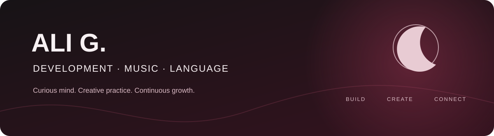
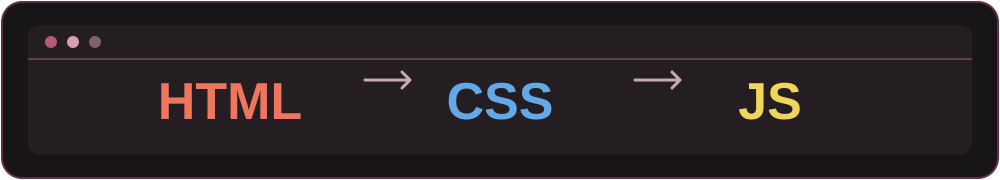
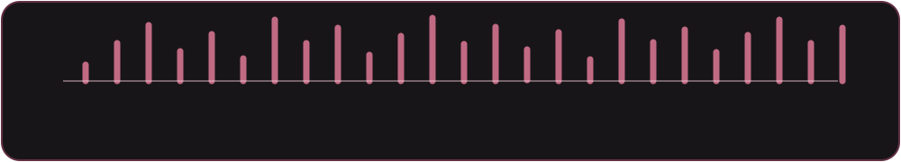
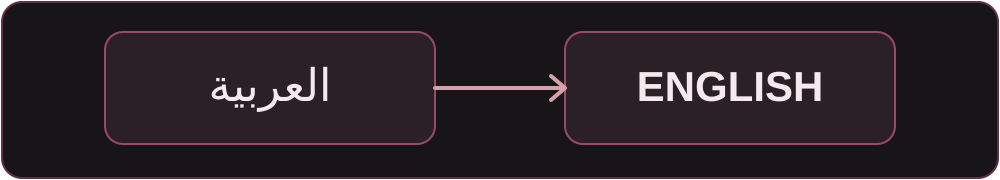
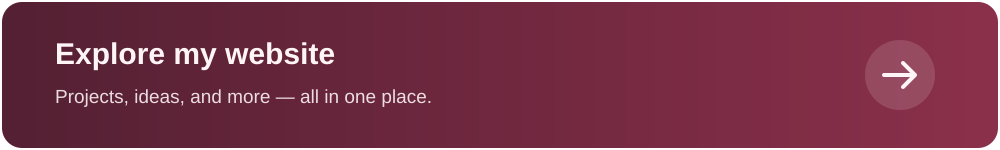

# Ali G.

### Front-End Developer · Music Producer · Arabic–English Translator

I’m a curious, creative, and self-driven builder who enjoys turning ideas into useful digital experiences and expressive creative work. I work across **front-end development**, **music production**, and **language**, bringing a mix of technical thinking, attention to detail, and creativity to every project.

---

## 👋 About Me

I’m interested in the space where technology and creativity meet. I enjoy learning how things work, experimenting with new ideas, and developing practical skills through hands-on projects.

My work and interests span three main areas:

- **Building for the web:** creating clean, responsive front-end experiences with HTML, CSS, and JavaScript.
- **Making music:** developing ideas through music production, with an interest in sound design, arrangement, mixing, and mastering.
- **Working with language:** supporting communication between Arabic and English through translation, with care for meaning, tone, and context.

I value clear communication, thoughtful design, continuous learning, and work that feels purposeful.

## 🧰 Skills

### 💻 Front-End Development

| Technology | Focus |
|---|---|
| HTML5 | Semantic page structure and accessible content |
| CSS3 | Layout, styling, responsive design, and visual polish |
| JavaScript | Core interactivity and browser-side functionality |

  
  
  

### 🎧 Music Production

Music is both a creative outlet and a craft I continue to develop. I have completed a **Steinberg music-production certificate** and focus on improving my production workflow and technical listening skills.

Areas of interest and practice include:

- Music production and arrangement
- Sound selection and sound design
- Mixing and mastering development
- Electronic music and atmospheric, expressive sounds

### 🌐 Arabic–English Translation

I work with **Arabic and English translation**, aiming to preserve the original meaning while making the result clear and natural for its intended audience.

My approach emphasizes:

- Meaning and context over word-for-word substitution
- Clear, readable phrasing
- Attention to tone and cultural nuance
- Careful review for consistency

## 🧭 How I Work

- **Curious by nature:** I enjoy exploring unfamiliar subjects and learning by doing.
- **Creative and analytical:** I like combining structure with experimentation.
- **Detail-conscious:** I care about clarity, usability, and the quality of the final result.
- **Always developing:** I see every project as an opportunity to improve my skills.

## 🚀 Explore My Work

Want to see what I’m building and explore more?

**[ aligh8991.github.io ](https://aligh8991.github.io)**

---

*Technology. Sound. Language. Always learning, always creating.*

